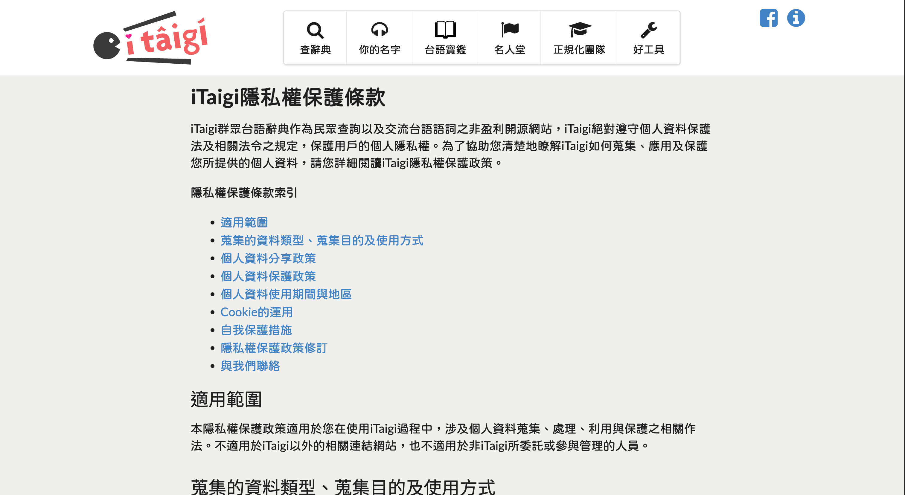

# iTaigiDataMirror

Data mirror for iTaigi. This site provides direct access to the exported iTaigi crowdsourced dictionary data. The files are hosted on GitHub Pages for easy access.

## Chu-liāu Pán-koân

版權聲明

- 程式授權：[MIT License](https://github.com/i3thuan5/itaigi)
- 辭典內容：[CC0「不保留權利」授權](https://creativecommons.org/public-domain/cc0/)
- [iTaigi隱私權保護條款](https://itaigi.tw/privacy)

## Latest Version

- **Version ID:** `20260906-2320`
- **Last Updated:** 2026-09-06

You can check [**manifest.json**](./public/manifest.json) for the latest version information programmatically.

## Accessing Files

The files are organized by version. The latest files are in `public/20260906-2320/`.

### Text Data (Dictionary)

- [**iTaigiSuTian.csv** (Dictionary Data CSV)](./public/20260906-2320/bunji/iTaigiSuTian.csv)
- [**iTaigiSuTian.json** (Dictionary Data JSON)](./public/20260906-2320/bunji/iTaigiSuTian.json)

### Data Fields

| Field  | Description                                      |
|--------|--------------------------------------------------|
| `華語` | Mandarin Chinese gloss |
| `漢字` | Taigi Han characters |
| `羅馬字` | Taigi Roman Orthography (Tâi-lô) |
| `來源` | Contributor name or `匿名` (anonymous) |

## Chu-liāu bāng-chí

辭典資料下載

1. [iTaigi 匯出資料](https://itaigi.tw/%E5%8C%AF%E5%87%BA%E8%B3%87%E6%96%99)

## Source

Original data source: <https://itaigi.tw/>
